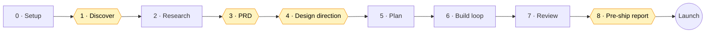

<div align="center">

# minhs-website

**A Claude Code skill that takes a website from idea to launch.**
Interview → research → PRD → design → plan → build → audit → ship, with approval gates and a team of specialist agents on cost-matched models.

[](LICENSE)
[](https://docs.claude.com/en/docs/claude-code/skills)
[](#agents-and-model-routing)
[](#audit-scripts)
[](#audit-scripts)

[Install](#install) · [Build mode](#build-mode) · [Agents](#agents-and-model-routing) · [Audit scripts](#audit-scripts) · [Guides](#guides)

</div>

---

## Why

Ask an AI for a website and you get the average of every website: purple gradients, three feature cards, "Get Started / Learn More", invented testimonials. That happens when nothing was decided, so every choice falls back to the most common pattern.

This skill makes the decisions first, writes them down, and checks the result:

- **Decisions before code.** An interview, competitor research and a PRD you approve before anything is built.
- **The right model per job.** Opus for security and architecture, Sonnet for building, design, copy and QA, Haiku for mechanical fixes.
- **Proof, not "done".** Every task has a done-check the lead runs itself. Three zero-dependency scanners catch security holes, janky motion and AI-slop tells.
- **Nothing ships without you.** A pre-ship report and an explicit yes before deploy.

## Install

```bash
git clone https://github.com/Vecnasurvivor/minhs-website ~/.claude/skills/minhs-website
```

Optional, for Build mode: install the 8 agents so the lead can delegate to them.

```bash
cp ~/.claude/skills/minhs-website/agents/*.md ~/.claude/agents/
```

Start a new Claude Code session, then ask for a website, or type `/minhs-website`.

> [!TIP]
> Without the agents installed, Build mode still works: the lead uses the built-in `general-purpose` agent with the model from the routing table and the role text from `agents/<name>.md`.

## Three modes

| You say | Mode | What happens |
|---|---|---|
| "Build me a website", "redesign our site" | **Build** | The full phased workflow below |
| "Add a pricing page", "animate the hero" | **Change** | Reads the project's `CLAUDE.md` / `docs/PLAN.md`, uses the matching guide, logs to `docs/LOG.md` |
| "Is this ready to launch?", "audit the site" | **Audit** | Launch checklist plus the audit scripts |

## Build mode



Hexagons are **⛔ gates**: the lead stops and waits for your answer, and never assumes yes.

| # | Phase | Who | Output |
|---|---|---|---|
| 0 | Setup | lead | Looks for an existing site first, then creates the project files |
| 1 | Discover ⛔ | lead | Up to 2 rounds of popup questions, defaults for the rest |
| 2 | Research | `web-researcher` | `docs/RESEARCH.md`: 5–8 competitors, patterns to borrow, clichés to avoid |
| 3 | PRD ⛔ | lead | `docs/PRD.md`: goal, audience, pages, features, non-goals, success metric |
| 4 | Design ⛔ | `web-designer` | 2–3 distinct directions; your pick becomes tokens in `CLAUDE.md` |
| 5 | Plan | lead + `web-architect` | `docs/PLAN.md` in vertical slices, each task with an owner, files and a done-check |
| 6 | Build loop | `web-builder`, `web-copywriter` | Tasks delegated, verified by the lead, ticked and logged |
| 7 | Review | `web-security`, `web-qa`, `web-polish` | Security review, browser QA at 375 px and 1440 px, audits, mechanical fixes |
| 8 | Pre-ship ⛔ | lead | What was built vs the PRD, audit results, what still needs you |

Every project keeps its state in plain files, so any session can pick it up:

```
your-site/
├── CLAUDE.md          # stack, design tokens, rules: the summary every agent reads
└── docs/
    ├── PRD.md         # what we're building and why (approved)
    ├── RESEARCH.md    # competitors and references
    ├── PLAN.md        # tasks with owner, model, files, done-check
    └── LOG.md         # one line per decision, task and approval
```

## Agents and model routing

The lead (your main session) plans, talks to you and verifies. Agents do scoped work, each with its model pinned.

| Agent | Model | Does | Never |
|---|---|---|---|
| `web-architect` |  | Plan and stack review, data model, auth, hard bugs | Writes routine UI |
| `web-security` |  | Security review of auth, payments, webhooks, config | Skims instead of reading the handlers |
| `web-researcher` |  | Competitor and reference research | Copies anyone's text or design |
| `web-designer` |  | Directions, tokens, layout, component styling | Picks defaults |
| `web-copywriter` |  | Headlines, page copy, CTAs, microcopy, meta | Invents claims, stats or reviews |
| `web-builder` |  | One PLAN task: pages, components, forms, API routes | Works outside its brief |
| `web-qa` |  | Browser testing, a11y, Lighthouse, audits | Fixes code (it reports) |
| `web-polish` |  | Alt text, meta tags, sitemap, image compression, renames | Makes design or logic calls |

**Routing rules:** anything where a mistake leaks data or money goes to Opus. Building, writing, testing and research go to Sonnet. Well-specified repetitive edits go to Haiku. A task that fails twice is re-run one tier up and logged.

## Audit scripts

Pure Python standard library: no install, no network. Each exits `1` when it finds issues, so they drop straight into CI.

| Script | Checks |
|---|---|
| [`launch_audit.py`](scripts/launch_audit.py) | Hardcoded keys, secrets in public env vars, tokens in `localStorage`, open CORS, weak password hashes, sensitive logging, missing alt text, SEO and legal-page basics |
| [`motion_audit.py`](scripts/motion_audit.py) | Animating layout properties, missing `prefers-reduced-motion`, oversized glTF / Rive / Lottie files, duplicate animation libraries |
| [`slop_scan.py`](scripts/slop_scan.py) | 15 tells of AI-generated sites, scored 0–100, with a fix for each |

```bash
python3 scripts/launch_audit.py path/to/site
python3 scripts/motion_audit.py path/to/site
python3 scripts/slop_scan.py path/to/site --fail-under 80   # also: --json, --list-rules
python3 scripts/launch_audit.py --selftest x                # each scanner tests itself
```

`slop_scan.py` against the two sites in [`examples/`](examples):

```console
$ python3 scripts/slop_scan.py examples/good-site
slop_scan: 2 files, 0 findings, score 100/100 (clean: no strong AI-slop tells found)

$ python3 scripts/slop_scan.py examples/slop-site
slop_scan: 2 files, 20 findings, score 0/100 (reads as AI-generated)

[HIGH] Purple / indigo gradient  (purple-gradient, 3x)
[HIGH] Gradient-filled headline text  (gradient-text, 2x)
[HIGH] Placeholder content shipped  (placeholder-content, 1x)
[MEDIUM] Emoji used as icons  (emoji-icons, 1x)
[MEDIUM] Three identical feature cards  (feature-card-grid, 1x)
[MEDIUM] Unverified social-proof numbers  (fake-social-proof, 1x)
[LOW] Default 'Get Started / Learn More' pair  (default-cta-pair, 1x)
...
```

> [!NOTE]
> The scanners flag patterns. A clean score doesn't make a design good, and some things (database rules, host headers, dashboards) stay on the manual checklist in [`launch-checklist.md`](references/launch-checklist.md).

## Guides

<details>
<summary><b>Process</b>: workflow, agents, discovery, design, build, launch</summary>

| Guide | Covers |
|---|---|
| [`workflow.md`](references/workflow.md) | The full idea → launch process, gates and project files |
| [`agents.md`](references/agents.md) | Model routing, the handoff brief template, parallelism |
| [`discovery.md`](references/discovery.md) | Interview questions, competitor research method |
| [`design.md`](references/design.md) | Design directions, tokens, anti-slop rules, UI rules, copy |
| [`build.md`](references/build.md) | Stack choice, structure, integrations, testing, deploy |
| [`launch-checklist.md`](references/launch-checklist.md) | Security, SEO, performance, accessibility, legal pages |

</details>

<details>
<summary><b>Motion</b>: scroll, timelines, springs, Lottie/Rive, components</summary>

| Guide | Covers |
|---|---|
| [`scroll.md`](references/scroll.md) | Scroll reveals, scroll-driven effects, sticky sections |
| [`timelines.md`](references/timelines.md) | Timelines, staggers, SVG drawing and morphing, counters |
| [`springs-react.md`](references/springs-react.md) | React springs, drag, layout and exit animation |
| [`vector.md`](references/vector.md) | Lottie, dotLottie and Rive designer files |
| [`components.md`](references/components.md) | Ready-made animated components (Magic UI, React Bits) |

</details>

<details>
<summary><b>3D, VR and AR</b>: decorative depth to full scenes</summary>

| Guide | Covers |
|---|---|
| [`3d-decorative.md`](references/3d-decorative.md) | Tilt, animated backgrounds, Vanta, Zdog |
| [`3d-scenes.md`](references/3d-scenes.md) | model-viewer, Spline, A-Frame / WebXR, three.js and r3f |
| [`3d-assets.md`](references/3d-assets.md) | Blender and Substance → optimized glTF |

</details>

### Motion ladder

Stop at the first rung that works:

1. **CSS**: transitions, `@keyframes`, scroll-driven animations, View Transitions
2. **Web Animations API**: `el.animate()`
3. **One library per job**: Anime.js (timelines, SVG), Motion (React), dotLottie / Rive (designer files)
4. **3D**, only when depth is the point

## Non-negotiables

- [x] No invented content, stats, reviews or logos. Placeholders are marked `[NEEDS: …]` and listed in the pre-ship report.
- [x] Animate `transform` and `opacity` only, respect `prefers-reduced-motion`, lazy-load 3D and big media with a static fallback.
- [x] Secrets stay server-side, and permissions and inputs are checked on the server.
- [x] Lighthouse mobile ≥ 90, WCAG AA contrast, works at 375 px, usable by keyboard.
- [x] Nothing ships without the pre-ship report and your yes.

## Repository layout

```
minhs-website/
├── SKILL.md           # entry point: mode picker, guide index, non-negotiables
├── agents/            # 8 web-* agents, each with its model pinned
├── references/        # 15 guides, loaded only when a task needs them
├── templates/         # CLAUDE.md, PRD, PLAN, LOG, RESEARCH for new projects
├── scripts/           # launch_audit.py, motion_audit.py, slop_scan.py
└── examples/          # good-site and slop-site, for testing slop_scan.py
```

## License

[MIT](LICENSE)
